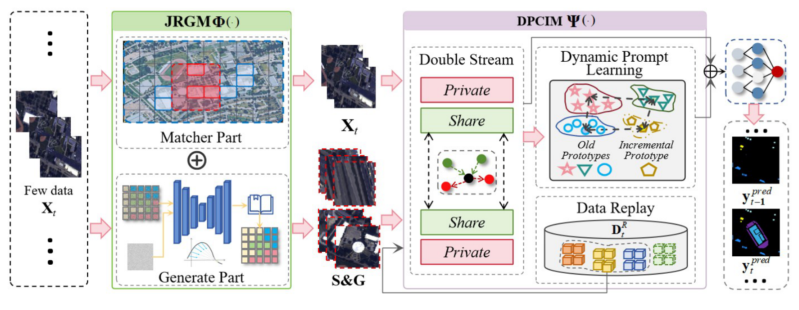
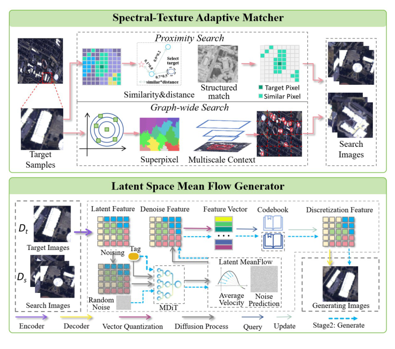
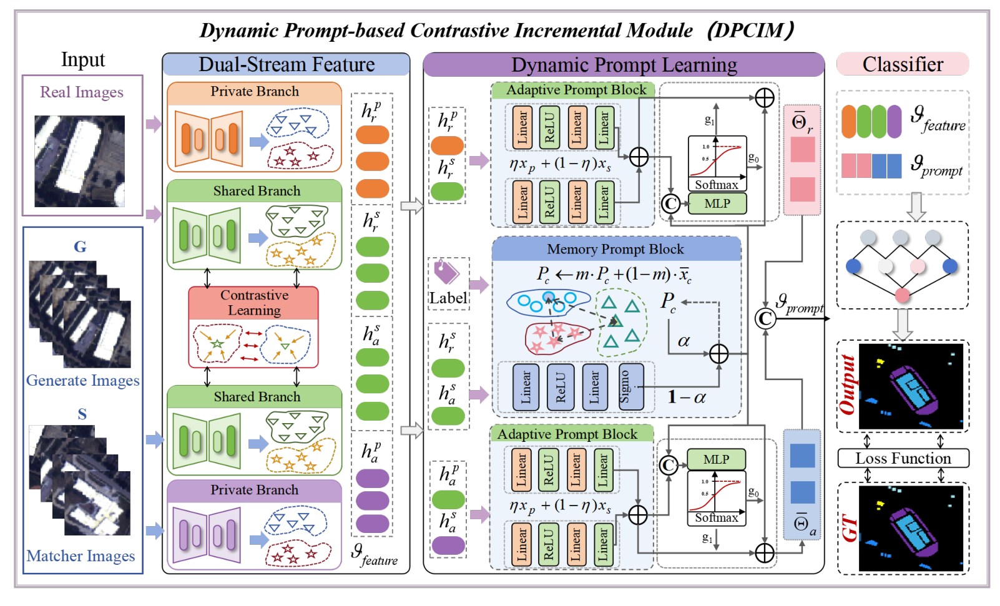

# Dual-Augmented Contrastive Prompt Network for Few-Shot Class-Incremental Hyperspectral Image Classification

Jiahui Qu, Wenqian Dong, Yusen Zhu, Yunsong Li, Qian Du

**Keywords:** few-shot classification, class-incremental learning, image generation, image matching, prompt learning

## Method

### Overview of DCPNet




*Fig. 2. Overview of the proposed DCPNet framework for few-shot class-incremental hyperspectral image classification. In the data augmentation phase, JRGM enriches limited training samples through local-global retrieval and latent-space mean flow generation. In the incremental learning phase, DPICM extracts shared and private features from real and augmented data and integrates dynamic prompting to coordinate old-class preservation and new-class adaptation.*

### Joint Retrieval and Generation Module (JRGM)




*Fig. 3. Structure of the Joint Retrieval and Generation Module (JRGM), which combines local-global retrieval by the Spectral-Texture Adaptive Matcher with sample generation by the Latent Space Mean Flow Generator to enrich limited training data.*

### Dynamic Prompt-based Contrastive Incremental Module (DPICM)




*Fig. 4. Illustration of the DPICM module. Dual-stream encoders extract shared and private features from real and augmented data, while adaptive and memory prompts balance new-class adaptation and old-class knowledge preservation. During incremental learning, the feature encoders and invariant prompts remain frozen, whereas adaptive prompts are updated for newly introduced classes.*

## Datasets

### Data specifications


| Dataset          | Sensor          | Image size | Bands | GSD   | Total classes |
| ---------------- | --------------- | ---------- | ----- | ----- | ------------- |
| Salinas          | AVIRIS          | 512 × 217  | 204   | —     | 16            |
| Pavia University | ROSIS           | 610 × 340  | 103   | 1.3 m | 9             |
| Houston 2013     | ITRES CASI-1500 | 349 × 1905 | 144   | 2.5 m | 15            |

### Class-incremental experimental setting

Each experiment consists of **one base session followed by two incremental sessions**, and the class budget of every session is fixed as follows. Only **5 labeled samples per class** are used in all sessions (the base session included), and samples are **9 × 9** patches. In incremental session *i*, the model is trained on the newly introduced classes plus replayed samples of the previously learned classes, and is evaluated on all classes learned up to that session.


| Dataset          | Base session    | Incremental session 1          | Incremental session 2           |
| ---------------- | --------------- | ------------------------------ | ------------------------------- |
| Salinas          | 6 classes (1–6) | +5 classes (7–11) → 11 classes | +5 classes (12–16) → 16 classes |
| Pavia University | 3 classes (1–3) | +3 classes (4–6) → 6 classes   | +3 classes (7–9) → 9 classes    |
| Houston 2013     | 5 classes (1–5) | +5 classes (6–10) → 10 classes | +5 classes (11–15) → 15 classes |

## Requirements

The model is implemented in PyTorch with Python 3.8.19 on Ubuntu, and experiments are conducted on an NVIDIA GeForce RTX 2080 Ti GPU.


```
Python >= 3.8, PyTorch >= 1.10 (CUDA recommended)
torch, torchvision, numpy, scipy, scikit-learn, scikit-image,
matplotlib, einops, tqdm, Pillow, mamba-ssm
```


```
pip install torch torchvision numpy scipy scikit-learn scikit-image matplotlib einops tqdm pillow mamba-ssm
```
